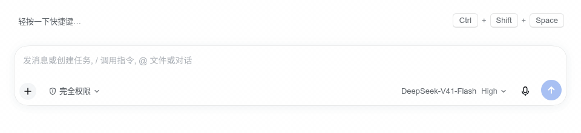
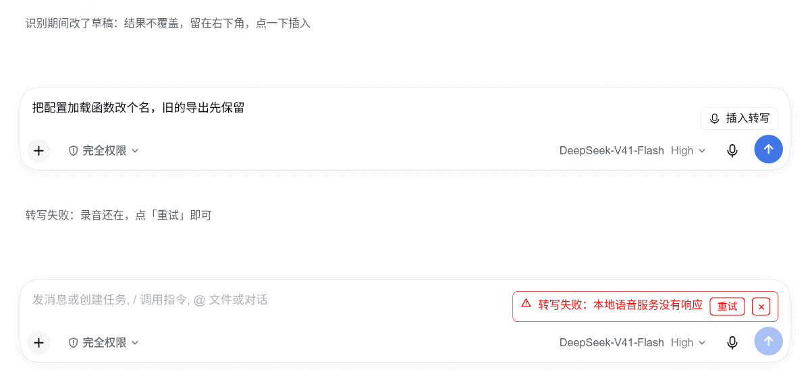
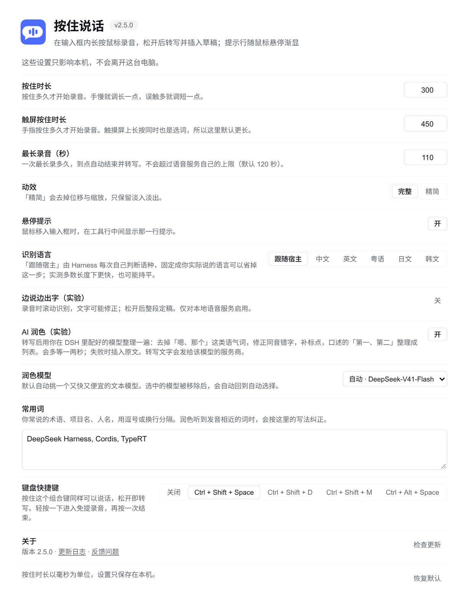
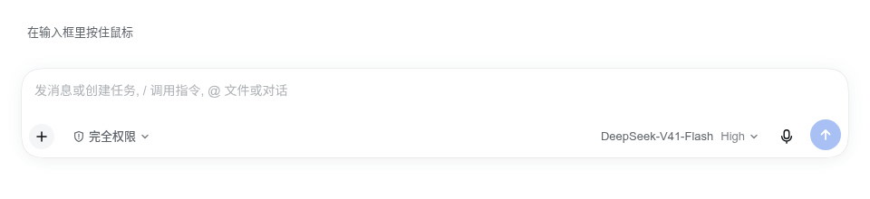
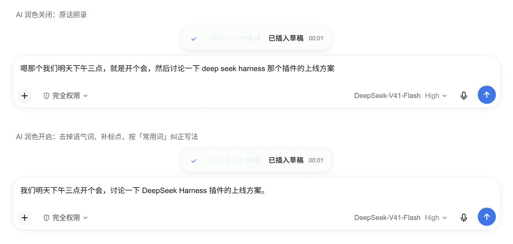

# 按住说话

在 [DeepSeek Harness](https://github.com/deepseek-ai/deepseek-harness) 的输入框里按住鼠标说话，松开后转写成草稿。**不会自动发送。**

[](https://github.com/jryang1997/dsh-hold-to-dictate/actions/workflows/check.yml)
[](https://github.com/jryang1997/dsh-hold-to-dictate/tags)
[](LICENSE)

**简体中文** · [English](README.en.md)

<p align="center">
  
</p>

<p align="center">
  
</p>

## 有什么不同

- **不另装识别引擎**：没有任何依赖，复用官方语音输入模块已经准备好的本地模型和语言列表，不多下载一套模型，也不用编译原生模块。
- **鼠标、触屏、键盘都能用**：鼠标按住约 0.3 秒；触屏单独 450 ms 阈值，避开长按选词；也可以按住 `Ctrl + Shift + Space`，`Esc` 取消。
- **长段口述不用一直按着**：轻按一下快捷键进入免提录音，说完再按一次结束。
- **不覆盖你的修改**：识别期间你改了草稿，结果退到右下角的小标签里，点一下才插入。
- **失败不丢录音**：服务一时连不上，可以对同一段录音点**重试**。
- **边说边出字（实验）**：长录音在句间停顿处分段提交，只重读新的部分；松开后仍以整段录音定稿。
- **从不自动发送**，文字只进草稿。

## 装之前：两样东西要先就位

这个插件不自带识别引擎，它复用官方语音输入模块的服务。

| 需要什么 | 怎么确认 |
|---|---|
| 官方模块 `@deepseek-ai/dsh-experimental-voice-input-bundle` | **设置 → 插件** 里已安装、已启用 |
| 本地识别模型 | 点输入框旁的官方麦克风按钮，按提示「下载并准备」 |

模型没准备好时，插件会在录音界面上直接告诉你该去哪里点。但如果整个语音模块缺失，它按设计**不注册任何东西**，界面上不会有任何反应，所以先确认模块在位。

## 安装

### 交给 Agent（推荐）

在 DeepSeek Harness 中切换到 **Creator 模式**，把下面这段发给 Agent：

```text
请使用 plugin_manager，在当前 DeepSeek Harness 配置中安装并启用按住说话插件。

先检查官方语音输入模块 @deepseek-ai/dsh-experimental-voice-input-bundle：
缺失时安装，已安装则确认启用。

然后安装本插件：
action: install_bundle
target: github:jryang1997/dsh-hold-to-dictate
如果已经安装，请检查启用状态，避免重复安装。

请检查语音识别模型是否已准备好。需要我下载模型或授权麦克风时，
告诉我在哪里操作。完成后告诉我如何刷新页面并测试。
```

装完刷新页面。

<details>
<summary>命令行安装</summary>

已有可用的语音输入模块时，也可以运行：

```bash
dsh plugin --profile <profile> add github:jryang1997/dsh-hold-to-dictate
```

把 `<profile>` 换成实际配置名。桌面应用的 `desktop` 配置由应用独占管理，命令行会被拒绝，请用上面的 Agent 方式。

</details>

## 怎么用

鼠标按住约 0.3 秒后开始录音。

| 操作 | 怎么做 |
|---|---|
| 录音 | 在输入框内按住鼠标，或按 `Ctrl + Shift + Space` |
| 转写 | 松开 |
| 免提录音 | 轻按一下快捷键（不到 0.3 秒就松开），胶囊显示「再按结束」；说完再按一次快捷键转写 |
| 取消 | 向上拖出输入框，看到取消提示后松开；也可以按 `Esc` |
| 插入被搁置的结果 | 识别期间改动过草稿时，转写文字会留在右下角的小标签里，点一下插到光标处 |

<p align="center">
  
</p>

鼠标移入输入框时，工具行中间会显示一行提示，写着「按住鼠标语音输入文字 · 上滑取消」。工具行中间剩下的宽度不足 48 像素时（比如模型名很长），这行提示会被丢掉，而不是压在别的控件上。浅色、深色、降低透明度、增强对比度都正常。

<p align="center">
  
</p>

## 设置

**设置 → 插件 → 按住说话**。这些设置只影响本机。

| 设置 | 默认 | 可选项 |
|---|---|---|
| 按住时长 | 300 毫秒 | 150 至 800 毫秒。手慢调长，误触调短 |
| 触屏按住时长 | 450 毫秒 | 250 至 1200 毫秒。比鼠标长，因为触屏长按同时是选词 |
| 最长录音 | 110 秒 | 15 至 600 秒。到点自动结束并转写；不会超过语音服务自己的上限（默认 120 秒） |
| 识别语言 | 跟随宿主 | 跟随宿主 / 中文 / 英文 / 粤语 / 日文 / 韩文 |
| 键盘快捷键 | `Ctrl + Shift + Space` | 关闭 / `Ctrl + Shift + Space` / `Ctrl + Shift + D` / `Ctrl + Shift + M` / `Ctrl + Alt + Space` |
| 悬停提示 | 开 | 开 / 关 |
| AI 润色（实验） | 关 | 开 / 关。见下文 |
| 润色模型 | 自动 | 开启润色后出现。自动或任一已配置的文本模型，选择规则见下文 |
| 强制关闭思考 | 关 | 开启润色后出现。只有当前模型明确声明 `off` 才能新开启；开启后每次请求和重试都必须使用 `off`，否则保留原文 |
| 常用词 | 空 | 开启润色后出现。逗号或换行分隔，最多 60 个 |
| 动效 | 完整 | 完整 / 精简（去掉位移与缩放，只保留淡入淡出） |
| 边说边出字（实验） | 关 | 开 / 关，见下节 |

固定「识别语言」可以省掉宿主每次请求自己判断语种的那一步。实测多数长度下更快，也可能持平。

<details>
<summary>设置页面截图（v2.5.0）</summary>

<p align="center">
  
</p>

</details>

## 边说边出字（实验）

开启后，录音期间会滚动调用官方本地语音模块，把识别结果写进草稿；松开后用整段录音定稿。

<p align="center">
  
</p>

它的行为分两段：

- **短句** 每次都重读整段录音，所以后面的结果可以修正前面的文字。
- **长录音** 一次整段识别超过约 0.7 秒后，改为在**句间停顿**处提交已定稿部分，之后只识别停顿以来的新音频。停顿从录音本身检测，切点取静音段中点，所以不会切在词中间；没有句间停顿就不提交，退回整段识别。已提交的文字在本次录音内冻结。

松开后仍然用整段录音定稿，两段都不改变你最终留下的文字。

实测同一段 21 秒带停顿音频、只换代码版本，出字刷新从 14 次升到 46 次，首次出字从 1246 毫秒降到 802 毫秒。旧版变慢的瓶颈是插件自己固定的 1 秒等待，不是模型。

只对本地语音服务和不含引用芯片的纯文本草稿启用，其他环境沿用松开识别。录音中手动编辑草稿会停止自动替换，最终结果保留在小标签里供你手动插入。两种模式都不是模型原生逐字流。

## AI 润色（实验）

默认关闭，效果还在调优。开启后，转写完成会用你在 DSH 里**已经配好的模型**整理一遍再插入，不需要另配 API Key：

- 去掉「嗯、呃、那个、就是」这类语气词和口吃，保留「吧、呢」这类有意思的语气
- 口误自我纠正（「不对，我说的是…」）只留最后的说法
- 修正同音错字和听错的术语（根木鹿 → 根目录，脱肯 → Token），补标点和中英文间空格
- 口述「三件事，第一…第二…」时整理成 `1. 2. 3.` 列表；普通叙述不硬拆

<p align="center">
  
</p>

听错的专业词最好的办法是填「常用词」：把你常说的术语、项目名、人名填进去（如 `Claude Code, DSH, Kubernetes`），润色听到发音相近的词会按你的写法纠正，但不会凭空插入。列表由代码按「第一 / 首先 / 一是 / first」这类序数词排版；模型改动太大时会被拒绝并插入原文。

它不改写、不翻译、不回答你说的问题，也**不会自动发送**。自动选择优先 DeepSeek 官方渠道，再按模型名称优先选择 Flash / Mini / Lite 等轻量文本模型。默认使用模型声明中最低的已识别推理档位，按 `off → none → minimal → low` 选择；都没有就沿用服务商默认。`none` 和 `minimal` 不等于已确认支持关闭思考。消息会经过该模型的服务商，在意隐私就保持关闭。

「强制关闭思考」默认关闭。不开启时，模型声明 `off` 就已经会使用 `off`；开启是要求每次请求和重试都必须使用明确的 `off`，不能退到 `low` 或省略参数。设置页只查询当前选中模型或自动选择的实际模型，显示声明的档位、自动档位及关闭支持状态。这些是 Host 提供的能力声明，不是对服务商实际行为的验证。换模型后若不支持关闭，已保存的开关仍会显示，可以随时关掉。

想减少等待，建议选用明确声明支持 `off` 的 DeepSeek 官方模型。对这类模型，插件默认就会关闭思考，无需额外开启「强制关闭思考」。第三方渠道若只声明 `low / high / max`，插件就无法强制关闭思考，开关不能补出服务没有声明的能力。即使名称同为 DeepSeek V4.1 Flash，不同渠道的等待也可能不同；模型和服务延迟都会影响完成时间。

任何失败，包括无法满足强制关闭、没配模型、请求超时或返回空内容，都会保留原文并提示原因。模型发现另有耗时，之后的模型请求共用 15 秒预算：第一个模型很快报错时最多换下一个模型重试一次，剩余时间不足就不再重试。强制关闭时，重试候选也必须声明并保留 `off`。润色中按 Esc 会和转写一样取消。这部分运行在 Host 侧，由官方的 `@deepseek-ai/dsh-llm` 提供；Host 缺少它或版本不支持新接口时，无法执行强制关闭，保留原文。

提示词参考了 [dsh-better-input](https://github.com/DIAG5/dsh-better-input)（MIT）的润色规则。

## 出问题的时候

| 现象 | 原因和处理 |
|---|---|
| 长按完全没反应 | 多半是官方语音输入模块被停用了。插件按设计静默降级，不会报错，所以这里没提示。去 **设置 → 插件** 确认它已启用 |
| 提示语音模型没准备好 | 到 **设置 → 插件 → 语音输入** 点一次「下载并准备」 |
| 提示麦克风不可用 | 在系统设置里允许 Harness 使用麦克风，然后重试 |
| 转写失败，显示服务不可达 | 识别服务那一刻连不上。失败不会吃掉已经录到的音频，用胶囊上的**重试**按钮对同一段录音再来一次，或关掉重录 |

识别期间改过草稿时，结果会退到右下角的小标签里，不会覆盖你的编辑。

## 已知限制

- 长录音分段提交后，已提交的临时文字不再自我修正。
- 一致性数字来自同一份录音棚素材、同一模型、单机、有限组数，不是跨素材保证。
- 自动化测试用的是假麦克风喂 WAV 加简化 DOM 桩。**真实麦克风与真实页面已实测可用。**真人即兴口述的停顿检测更难。噪声大时检测不到停顿，就保留整段识别，不会把词从句子中间切断。
- 录音时长默认最长 110 秒（设置里可调 15–600 秒），大小上限约 4 MiB；都不会超过语音服务声明的上限。

## 更新或卸载

GitHub 安装不会自动更新。pnpm 会把 GitHub 依赖钉在某个具体 commit 上，仓库发了新版也不会自动跟随。更新要走「先移除再安装」：

```text
请更新按住说话插件：使用 plugin_manager，先以 action: remove_bundle、
target: @jryang1997/dsh-hold-to-dictate 移除旧安装，再以 action: install_bundle、
target: github:jryang1997/dsh-hold-to-dictate 安装，并提示我刷新页面。
保留官方语音输入模块。
```

装完刷新页面。本机设置会保留。

如果仍安装的是 v1.x 的旧包 `@jryang1997/dsh-composer-dictation`，先移除它再装上面的新包，避免同时启用两份插件。只需卸载时，移除 `@jryang1997/dsh-hold-to-dictate` 即可。

## 需要知道

识别使用 Harness 当前选择的语音服务。官方默认是本地 SenseVoice，音频不出这台电脑；如果你配置了云端服务，录音会发给该服务。

首页录屏是真机实录。其余截图和动图由插件自己的组件在无头浏览器里渲染：输入框外壳按 DSH 官方样式还原，麦克风是合成音频，识别和润色结果是示例文字。

社区插件，与 DeepSeek 无隶属关系。已在 DeepSeek Harness `0.2.0-rc.2` 上测试。

[版本记录](CHANGELOG.md) · [开发说明](CONTRIBUTING.md) · [实现笔记](docs/design.md) · [反馈问题](https://github.com/jryang1997/dsh-hold-to-dictate/issues) · [MIT](LICENSE)
